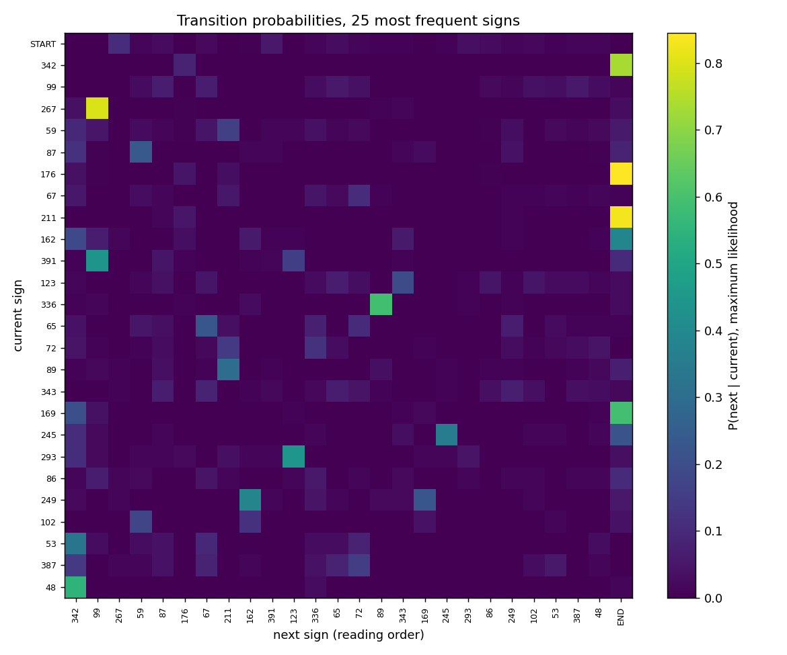
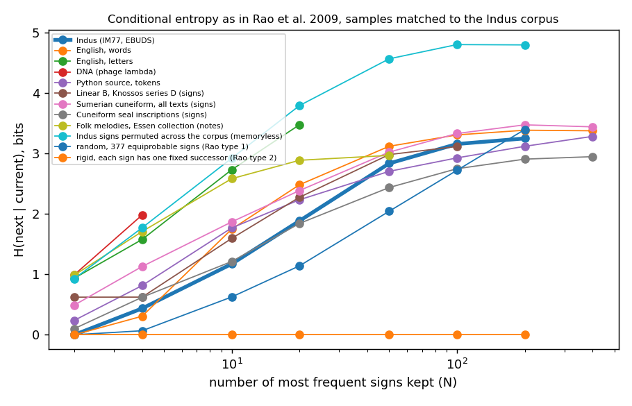
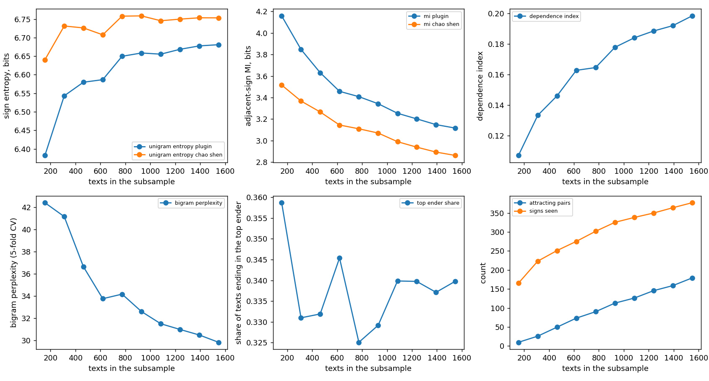

# Milestone 2 report: positional bias and Markov-chain modelling

Generated by `sequence_analysis/run_milestone2.py` from the IM77 corpus (Mahadevan 1977). Signs are Mahadevan numbers; sequences are in reading order unless stated.

**What this does and does not show.** The results show that sign order in the inscriptions is structured and non-random, and that the layout is consistent with right-to-left reading. They are not evidence that the inscriptions encode a language: published work disputes whether any of these statistics separates writing from structured non-linguistic sign systems (Sproat 2014; Rao et al. 2015), and an unreviewed 2026 preprint (Raghavendra, arXiv:2608.02999) reports that an invented non-linguistic system reproduces them.

## Corpus

| Filter step | Lines | Distinct texts | Sign tokens | Signs |
|---|---|---|---|---|
| all inscribed lines | 3573 | 2410 | 10679 | 417 |
| no illegible or lost sign | 2861 | 1849 | 8313 | 398 |
| no doubtful reading | 2591 | 1673 | 7448 | 393 |
| single-line only | 2406 | 1548 | 7000 | 377 |

Keeping one copy of each text after the last step gives **1548 texts, 7000 sign tokens, 377 signs**. Yadav et al. 2010 report 1548, 7000 and 377 for their filtered corpus (EBUDS), so the filter is reproduced exactly.
All statistics below use this filtered corpus except the direction test, which needs the per-line layout.

## Replication of Yadav et al. 2010

| Quantity | Published | This run |
|---|---|---|
| Perplexity, order 1 (Witten-Bell, backoff) | 68.82 | 74.58 (every held-out sign scored); 68.95 (unseen signs skipped) |
| Perplexity, order 2 (Witten-Bell, backoff) | 26.69 | 29.83 (every held-out sign scored); 26.88 (unseen signs skipped) |
| Perplexity, order 3 (Witten-Bell, backoff) | 26.09 | 29.18 (every held-out sign scored); 26.26 (unseen signs skipped) |
| Perplexity, order 4 (Witten-Bell, backoff) | 25.26 | 30.13 (every held-out sign scored); 27.11 (unseen signs skipped) |
| Perplexity, order 5 (Witten-Bell, backoff) | 25.26 | 30.32 (every held-out sign scored); 27.29 (unseen signs skipped) |
| Unigram entropy (bits) | 6.68 | 6.68 plug-in; 6.72 Miller-Madow |
| Adjacent-sign mutual information | 2.24 (unit not stated) | 3.12 bits (plug-in); 2.24 in nats with every copy of repeated texts kept |
| Distinct adjacent sign pairs observed | 2,178 (Sinha et al. 2009) | 2178 |
| Signs covering 80% of all tokens / text-beginners / text-enders | 69 / 82 / 23 | 69 / 82 / 23 |
| Three most frequent text-beginners | [267, 391, 293] | [267, 391, 293] |
| Three most frequent text-enders | [342, 176, 211] | [342, 176, 211] |
| Most frequent pair, count, log-likelihood ratio | 267 then 99, 168, 792.40 | 267 then 99, 168, 792.40 |
| Most frequent triplet, count | 336, 89, 211; 34 | [336, 89, 211]; 34 |
| Zipf-Mandelbrot fit (a, b, c) | 15.39, 2.59, 44.47 | 15.39, 2.60, 44.47 |
| Damaged-sign restoration, true sign inside the 90%-probability candidate set | 74% | 86.1%; 79.5% if the sign that crosses the 90% line is not counted |

Notes on comparability:

- **Perplexity.** The headline figure scores every held-out sign over a fixed vocabulary, and is higher than published. The second figure takes the vocabulary from each training fold and skips held-out signs never seen in training (1.6% of events), which is the default behaviour of the SRILM toolkit the paper used. It lands close to the published values for orders 1 to 3, so it is a candidate explanation of the gap, not a confirmed one: the paper does not state its split or options. Skipping drops the hardest events, so the headline figure is the more honest measure. Orders 4 and 5 are not reproduced under any of the four protocols tried (see Replication gaps below), so that gap is closed as unexplained.
- **Mutual information.** The paper does not define its estimator or unit. Computed in nats on the single-line corpus before repeated texts are reduced to one copy, the plug-in value is 2.239, which matches the published 2.24 to the stated precision. This is the likely explanation, but it rests on a numerical match only. The plug-in value is biased upward: with every token permuted across the corpus it is still 1.94 bits.
- **Restoration.** The published rule can be read two ways at the 90% boundary, and the two readings differ by several points.

## Language models compared (5-fold cross-validation over distinct texts)

| Model | Bits per event (mean, SD over folds) | Perplexity | Perplexity without end-of-text |
|---|---|---|---|
| uniform | 8.562, 0.000 | 378.00 | 378.00 |
| positional (no sign-to-sign dependence) | 5.970, 0.063 | 62.70 | 117.06 |
| witten-bell backoff n=1 | 6.221, 0.037 | 74.58 | 131.23 |
| witten-bell interpolated n=1 | 6.221, 0.037 | 74.58 | 131.23 |
| witten-bell backoff n=2 | 4.899, 0.092 | 29.83 | 51.49 |
| witten-bell interpolated n=2 | 4.909, 0.099 | 30.05 | 53.33 |
| witten-bell backoff n=3 | 4.867, 0.101 | 29.18 | 50.13 |
| witten-bell interpolated n=3 | 4.941, 0.105 | 30.72 | 55.77 |
| witten-bell backoff n=4 | 4.913, 0.111 | 30.13 | 51.30 |
| witten-bell interpolated n=4 | 5.045, 0.116 | 33.02 | 60.68 |
| witten-bell backoff n=5 | 4.922, 0.113 | 30.32 | 51.42 |
| witten-bell interpolated n=5 | 5.086, 0.117 | 33.98 | 62.62 |
| add-1 n=2 | 6.149, 0.051 | 70.94 | 106.21 |
| add-0.01 n=2 | 5.302, 0.124 | 39.44 | 68.60 |
| kneser-ney n=2 | 4.827, 0.087 | 28.38 | 49.09 |
| kneser-ney n=3 | 4.740, 0.089 | 26.73 | 46.28 |

The positional model, which knows only how far into the text a sign is, reaches 5.970 bits per event; the bigram model reaches 4.899. This baseline counts position from the start only; a baseline that also knows the distance to the end is under Robustness checks.
The vocabulary is fixed at the 377 signs of the filtered corpus plus end-of-text; every model gives unseen signs non-zero probability.

## Is sign order structured?

Adjacent-sign mutual information is 3.115 bits. After shuffling the signs inside each text it is 2.066 bits (95% of shuffles in [2.038, 2.094]; p < 0.001). With every token permuted across the whole corpus it is 1.935 bits, which is the size of the estimator's upward bias on data this sparse; the comparison is therefore against shuffles and not against zero.

Of the 2178 distinct adjacent pairs, 205 occur at least 5 times and were tested (log-likelihood ratio, Benjamini-Hochberg at 5%): 179 occur more often than chance and 4 less often. The same procedure on a corpus with all tokens permuted flags 1.1 pairs on average. Rarer pairs are listed but not tested, because the test is unreliable at expected counts below about 1. Full table with pointwise mutual information: `sign_pairs.csv`. Forward and backward transition matrices: `transition_matrices.npz`.

## Writing direction

**What this test can show.** The corpus stores each text in reading order and labels each line right-to-left or left-to-right. Each line was put back into its physical left-to-right layout using that label, and the measure of Ashraf & Sinha (2018) was applied to the signs at the two physical ends. Negative delta S and positive delta G mean the left end is the more predictable one, which in scripts of known direction goes with right-to-left reading.

The result is conditional on Mahadevan's labels and is not an independent verification of direction. In stored reading order the last-read end is the more concentrated one in both groups (delta S +0.395 for lines labelled right-to-left, +0.324 for left-to-right), so the physical values below are that fact combined with the label. What the data supports is: given the recorded labels, the concentrated end is on the physical left in the lines labelled right-to-left, which are 92% of lines with a recorded direction. A test that does not depend on the labels needs layout from another source, such as sign positions measured on photographs (Milestone 1's `bbox_xywh`) or the printed concordance. The proposal asks for 'verifying right-to-left syntax rules'; this report claims consistency with a right-to-left convention and makes no claim about syntax.

| Group | Lines | delta S (bootstrap SE) | delta S under within-line shuffle (95%) | p | delta G (bootstrap SE) |
|---|---|---|---|---|---|
| primary: labelled right-to-left, single-line | 2319 | -0.418 (0.013) | [-0.020, +0.019] | 0.001 | +0.141 (0.006) |
| same, duplicate texts removed | 1565 | -0.413 (0.018) | [-0.022, +0.022] | 0.001 | +0.162 (0.008) |
| labelled right-to-left, all lines | 2461 | -0.395 (0.013) | [-0.017, +0.019] | 0.001 | +0.142 (0.006) |
| labelled left-to-right, all lines | 210 | +0.324 (0.033) | [-0.068, +0.066] | 0.001 | -0.055 (0.005) |
| labelled left-to-right, single-line | 194 | +0.333 (0.034) | [-0.059, +0.062] | 0.001 | -0.051 (0.005) |
| right-to-left single-line, object_type = seal | 1314 | -0.444 (0.020) | [-0.026, +0.025] | 0.001 | +0.147 (0.007) |
| right-to-left single-line, object_type = sealing | 469 | -0.477 (0.027) | [-0.045, +0.041] | 0.001 | +0.088 (0.005) |
| right-to-left single-line, object_type = miniature tablet | 336 | -0.459 (0.032) | [-0.057, +0.053] | 0.001 | +0.035 (0.003) |
| right-to-left single-line, object_type = copper tablet | 118 | -0.603 (0.056) | [-0.080, +0.074] | 0.001 | +0.017 (0.002) |
| right-to-left single-line, site = Mohenjodaro | 1203 | -0.450 (0.019) | [-0.025, +0.028] | 0.001 | +0.134 (0.007) |
| right-to-left single-line, site = Harappa | 891 | -0.484 (0.020) | [-0.034, +0.033] | 0.001 | +0.100 (0.005) |
| primary, no top-1 text-beginner or ender at either end | 1418 | -0.286 (0.013) | [-0.021, +0.022] | 0.001 | +0.116 (0.006) |
| primary, no top-3 text-beginner or ender at either end | 950 | -0.209 (0.014) | [-0.024, +0.024] | 0.001 | +0.083 (0.006) |
| primary, no top-5 text-beginner or ender at either end | 714 | -0.157 (0.015) | [-0.026, +0.025] | 0.001 | +0.062 (0.006) |
| primary, no top-10 text-beginner or ender at either end | 421 | -0.091 (0.018) | [-0.038, +0.034] | 0.001 | +0.019 (0.006) |
| primary, no top-20 text-beginner or ender at either end | 156 | -0.004 (0.020) | [-0.044, +0.044] | 0.871 | +0.001 (0.007) |

In the primary group, sign 342 (the commonest text-ender) is at the physical left end of 766 lines and at the right end of 0, out of 2319. In lines labelled left-to-right it is at the left end of 0 and the right end of 40, out of 210. No exceptions in either group is what one would expect if the labels were assigned with the position of such signs in view.
Descriptively, the gap in delta S between the two labelled groups is -0.720, against [-0.094, +0.082] when labels are reassigned at random; this follows from the labels and is not separate evidence.

**Without the signs most likely to have guided the labels.** The rows 'no top-k text-beginner or ender at either end' drop every primary line whose physical left or right sign is among the k commonest text-beginners or text-enders (ranked on EBUDS). k = 1: delta S -0.286 on 1418 lines. k = 3: delta S -0.209 on 950 lines. k = 5: delta S -0.157 on 714 lines. k = 10: delta S -0.091 on 421 lines. k = 20: delta S -0.004 on 156 lines. The asymmetry is not carried by sign 342 alone, but it shrinks steadily as more end-marking signs are removed and is not detectable once the top 20 are excluded. Either the direction signal lives in a few dozen formulaic end signs, or those are the signs the labels were assigned from; this test cannot tell the two apart.

p is the share of within-line shuffles with an absolute delta S at least as large as observed; 0.001 is the smallest value 1,000 shuffles can give. delta S (entropy) is the headline measure because it is stable across group sizes. delta G (Gini) shrinks as a group gets smaller and sparser, so its size should not be compared between groups. delta G here is computed over the full 418-symbol sign list so that groups share one alphabet; over only the signs seen at either end, which is closer to Ashraf & Sinha's usage, the primary group gives +0.203. A bootstrap standard error is given in place of a percentile interval because both measures are biased on sparse counts and resampling repeats the bias.

Other limits: the left-to-right group is small and unrepresentative (many are miniature tablets from Harappa). Comparing forward and backward bigram perplexity is not a direction test: a maximum-likelihood bigram model scores a corpus identically in both directions (asserted in `ngram.py`).

## Error propagation from Milestone 1

Recognition errors (substitution, deletion, and insertion on a random side, in equal parts) were injected into the corpus and the analysis repeated.

| Injected sign error rate | delta S (mean, SD) | delta G (mean, SD) | Bigram perplexity | Top-20 pairs retained | Texts ending in the top ender |
|---|---|---|---|---|---|
| 0.000 | -0.418, 0.000 | +0.141, 0.000 | 29.8 | 100% | 34.0% |
| 0.050 | -0.383, 0.009 | +0.144, 0.006 | 36.5 | 94% | 32.8% |
| 0.100 | -0.353, 0.007 | +0.146, 0.004 | 44.3 | 93% | 31.3% |
| 0.150 | -0.325, 0.008 | +0.145, 0.007 | 51.6 | 92% | 30.2% |
| 0.200 | -0.299, 0.013 | +0.148, 0.011 | 60.6 | 88% | 29.1% |
| 0.237 (Milestone 1, synthetic) | -0.271, 0.012 | +0.138, 0.009 | 68.0 | 87% | 27.8% |
| 0.300 | -0.249, 0.010 | +0.144, 0.012 | 80.0 | 89% | 26.1% |

The conclusions weaken but do not reverse: the direction signal shrinks toward zero, the commonest pairs mostly survive, and perplexity rises steeply. Milestone 1's sign error rate (0.237) was measured on synthetic seals and is optimistic for real photographs. The injected errors are uniform over signs; a real classifier confuses similar-looking signs, which this does not model.

## Restoring a missing sign

With one sign removed and predicted from both neighbours by the bigram model (7000 trials, 5-fold): top-1 38.0%, top-5 62.4%, and the true sign is inside the 90%-probability candidate set 86.1% of the time (that set holds 44 signs on average). The published 74% uses the last criterion; it is not top-1 accuracy. This measures how predictable the notation is and says nothing about meaning.

| Model | Top-1 | Top-5 | Inside the 90% set | Same, strict | Mean size of the 90% set |
|---|---|---|---|---|---|
| witten-bell backoff n=2 | 38.0% | 62.4% | 86.1% | 79.5% | 44 |
| witten-bell backoff n=3 | 40.2% | 63.0% | 82.5% | 69.9% | 37 |
| kneser-ney n=2 | 38.7% | 63.2% | 86.7% | 77.0% | 55 |
| kneser-ney n=3 | 42.2% | 64.5% | 85.5% | 68.0% | 53 |

Each model scores a candidate by the probability of the whole text with the candidate in place, so the trigram also uses the sign two places away. It gains a few points of top-1 accuracy; the 90%-set figures are not comparable across models because the set sizes differ.

## Syntax: positional classes, class order and recurring segments

Each sign with at least 25 tokens is tested for a positional preference against what its texts' lengths imply (chi-square, Benjamini-Hochberg 5%) and assigned the position it over-uses most; the rest are 'free'. 67 signs qualify, covering 80% of tokens.

| Class | Signs | Commonest members |
|---|---|---|
| final | 9 | 342, 176, 211, 162, 169, 1, 15, 254, 12 |
| medial | 28 | 99, 59, 87, 67, 123, 336, 72, 89, 343, 48, 8, 347 |
| initial | 18 | 267, 391, 65, 293, 86, 249, 102, 53, 387, 171, 389, 17 |
| free | 12 | 245, 328, 28, 121, 341, 375, 127, 307, 180, 175, 373, 345 |

Class-to-class transitions against shuffles of the medial signs, first and last kept (the ten largest departures; z is in shuffle standard deviations):

| First | Then | Observed | Shuffled mean | z |
|---|---|---|---|---|
| final | final | 231 | 138.4 | +12.9 |
| medial | final | 515 | 633.2 | -9.9 |
| initial | medial | 697 | 594.4 | +8.8 |
| medial | initial | 366 | 286.6 | +7.9 |
| free | free | 84 | 56.9 | +6.6 |
| final | medial | 80 | 123.1 | -6.2 |
| final | initial | 22 | 56.1 | -6.1 |
| rare | medial | 340 | 407.3 | -6.0 |
| initial | rare | 173 | 213.4 | -4.8 |
| rare | rare | 250 | 217.5 | +4.7 |

**Rule checked on held-out texts.** With classes learnt on the training folds only: in the 722 held-out texts holding both an initial-class and a final-class sign, every initial-class sign precedes every final-class sign in 91.7% of texts, against 39.1% after shuffling all signs of the same texts and 85.2% after shuffling only the medial signs. Most of the rule restates the classes themselves (initial signs open texts, final signs close them); the order of initial- and final-class signs inside a text adds 6.5 points beyond that. The class transitions above use the same ends-kept null, so they measure order beyond position.

**Recurring segments.** Texts are cut between adjacent signs that are not strongly associated (pair seen at least 3 times with pointwise mutual information of at least 1 bit); pieces of two or more signs found in at least 3 distinct texts are kept. This yields 179 recurring segments. Segments learnt on training folds cover 47.7% of held-out sign tokens, against 11.0% of the same texts shuffled: much of the corpus is built from a stock of recurring sign groups.

| Segment (reading order) | Texts containing it | Occurrences: initial | medial | final | whole text |
|---|---|---|---|---|---|
| 267 99 | 168 | 144 | 20 | 3 | 1 |
| 342 1 | 48 | 0 | 5 | 43 | 0 |
| 347 342 | 56 | 0 | 6 | 50 | 0 |
| 391 99 | 56 | 51 | 5 | 0 | 0 |
| 342 176 | 59 | 0 | 2 | 57 | 0 |
| 403 87 | 20 | 3 | 15 | 1 | 1 |
| 48 342 | 38 | 6 | 11 | 20 | 1 |
| 245 245 | 33 | 6 | 7 | 20 | 0 |
| 293 123 343 | 25 | 25 | 0 | 0 | 0 |
| 150 123 | 22 | 21 | 1 | 0 | 0 |
| 59 211 | 31 | 0 | 3 | 28 | 0 |
| 8 342 | 58 | 0 | 15 | 42 | 1 |
| 391 123 | 20 | 19 | 0 | 0 | 1 |
| 222 254 | 15 | 0 | 2 | 12 | 1 |
| 216 254 | 19 | 1 | 2 | 15 | 1 |

**Do segments describe the texts better than signs?** On held-out folds, a model over recurring segments costs 5.47 bits per sign (segment unigram) and 4.91 (segment bigram), against 4.90 for the sign bigram (end of text counted, segments learnt on the training folds only). Treating the recurring segments as units does not predict held-out texts better than the sign bigram, so they are a description of frequent sign groups, not a better model of the texts.

Segments keep their own positions: the commonest opening pairs open texts and the pairs ending in 342 close them. These are distributional rules of the notation in reading order. They do not show that the segments are words, or that the classes are grammatical categories.

## Robustness checks

### Comparison with sign systems of known type

Each reference system is cut into samples with exactly the Indus text-length distribution (1548 texts, 7000 tokens), so sample size and text length, which bias every plug-in estimate, are matched; 10 samples each, mean (SD over samples). The samples are windows of a continuous stream, so a window can cross a line or text boundary of the reference system. Dependence index = share of a sign's uncertainty removed by knowing the previous sign, beyond what remains after shuffling signs within each text (0 = order carries nothing). Shuffling a short text keeps much of its pair structure, so even the rigid control stays far below 1. Python tokens are from the first 40 modules of the local Python 3.10 standard library, string and number literals collapsed to one token each.

| System | Signs in sample | H(sign), bits | H(next given current), bits | Dependence index, all signs | Dependence index, top 20 signs |
|---|---|---|---|---|---|
| Indus (IM77, EBUDS) | 377 | 6.68 | 3.22 | 0.198 (0.000) | 0.416 (0.000) |
| English, words | 1555 | 8.67 | 3.23 | 0.037 (0.001) | 0.232 (0.020) |
| English, letters | 26 | 4.18 | 3.53 | 0.123 (0.003) | 0.120 (0.004) |
| DNA (phage lambda) | 4 | 2.00 | 1.98 | 0.006 (0.001) | n/a (fewer than 20 signs) |
| Python source, tokens | 991 | 6.61 | 3.45 | 0.099 (0.005) | 0.326 (0.008) |
| Linear B, Knossos series D (signs) | 108 | 5.55 | 3.11 | 0.269 (0.005) | 0.358 (0.007) |
| Sumerian cuneiform, all texts (signs) | 685 | 7.94 | 3.38 | 0.085 (0.003) | 0.228 (0.016) |
| Cuneiform seal inscriptions (signs) | 439 | 6.66 | 2.95 | 0.202 (0.003) | 0.417 (0.011) |
| Folk melodies, Essen collection (notes) | 51 | 4.15 | 2.97 | 0.078 (0.003) | 0.081 (0.004) |
| Indus signs permuted across the corpus (memoryless) | 377 | 6.68 | 4.73 | 0.000 (0.002) | 0.001 (0.007) |
| random, 377 equiprobable signs (Rao type 1) | 377 | 8.52 | 3.87 | -0.000 (0.001) | 0.005 (0.055) |
| rigid, each sign has one fixed successor (Rao type 2) | 377 | 8.52 | 0.00 | 0.301 (0.001) | 0.299 (0.083) |

Read this as a scale, not a classification. On the all-signs index, 6 of the 8 real reference systems show weaker order dependence than the Indus corpus; Linear B, Knossos series D (signs), Cuneiform seal inscriptions (signs) show stronger. The closest system on both indices is Cuneiform seal inscriptions (signs) (0.202 and 0.417, against 0.198 and 0.416). Cuneiform seal inscriptions, short formulaic texts in a known language, score 0.202 and 0.417; long running text (the novel, Sumerian texts as a whole) and the non-linguistic melodies and DNA score lower. Linear B is indicative only: its file mixes real and augmented sequences, and cutting it into windows rather than whole lines changes its index markedly. Strong order dependence is what a formulaic notation would show, linguistic or not, so this places the Indus corpus beside short seal texts without saying which kind of system it is. Sproat's (2014) non-linguistic corpora (Mesopotamian deity symbols, Pictish stones, heraldry) are not publicly released and could not be included; the Linear B file mixes 513 real Knossos series D sequences with augmented ones it does not mark. The all-signs index for English words is compressed because, at 7000 tokens and over 1,500 word types, most word pairs occur once in both the real and the shuffled texts; the top-20 column avoids that.

### Position counted from both ends

All three models below predict signs only, given that the text has not ended (end-of-text is renormalised away), 5-fold CV.

| Model | Bits per sign (mean, SD over folds) | Perplexity |
|---|---|---|
| position from the start | 6.609, 0.080 | 97.6 |
| position from both ends (knows the text's length) | 6.345, 0.107 | 81.3 |
| bigram (Witten-Bell backoff) | 5.495, 0.120 | 45.1 |

Knowing the distance to both ends helps the positional model, but the bigram, which is not told the text's length, is still 0.85 bits per sign better. The bigram's gain is therefore sign-to-sign dependence, not position at either end.

### Cross-validation stability and unseen signs

| Model | Perplexity, mean over 10 random 5-fold splits | SD across splits | Range |
|---|---|---|---|
| positional (no sign-to-sign dependence) | 62.47 | 0.35 | 61.92 to 63.08 |
| kneser-ney n=2 | 28.40 | 0.13 | 28.21 to 28.62 |
| witten-bell backoff n=1 | 74.62 | 0.09 | 74.46 to 74.77 |
| witten-bell backoff n=2 | 29.84 | 0.12 | 29.62 to 30.02 |
| witten-bell backoff n=3 | 29.25 | 0.14 | 28.98 to 29.45 |

The bigram beats the positional baseline in 50 of 50 folds across all splits, by at least 0.99 bits per event. The SD across splits is under 1% of perplexity, so the gaps to the published values are not split noise.

Signs absent from the training fold are 1.6% of held-out events but 4.6% of the held-out bits (13.9 bits each against 4.7). Scoring only the other events with the same model gives perplexity 26.9 instead of 29.8: rare signs account for about a tenth of the headline figure.

### Corpus variants: duplicates, doubtful readings, a second transcription, merged sign groups

The main corpus already keeps one copy of each repeated text (EBUDS); the third row shows what counting every copy would change. The Wells/ICIT rows use an independent transcription with a different sign list (yajnadevam/indus-website, GPL-3.0; single-line texts with every sign readable, one copy each). That data records no doubtful readings and no usable physical layout, so the direction test cannot be repeated on it. 'Variant groups merged' maps every sign to the head of its Wells variant group (14 groups covering 83 signs). Perplexity is not comparable across sign lists, so it is also given relative to a uniform model.

| Corpus | Texts | Tokens | Signs | Dependence index | Pairs tested / attracting / avoiding | Top ender (share of texts) | Enders covering 80% | Bigram perplexity (relative to uniform) | Bits gained over positional | Top-20 pairs shared with main |
|---|---|---|---|---|---|---|---|---|---|---|
| IM77, EBUDS (main analysis) | 1548 | 7000 | 377 | 0.198 | 205 / 179 / 4 | 342 (34%) | 23 | 29.8 (0.079) | 1.07 | 20 |
| IM77, doubtful readings kept | 1704 | 7786 | 383 | 0.200 | 230 / 193 / 4 | 342 (35%) | 23 | 29.7 (0.077) | 1.05 | 18 |
| IM77, every copy of repeated texts kept | 2406 | 9597 | 377 | 0.231 | 292 / 256 / 4 | 342 (29%) | 17 | n/a: copies leak across folds | n/a | 17 |
| IM77, multi-line texts added, lines joined | 1611 | 7415 | 390 | 0.192 | 221 / 191 / 4 | 342 (33%) | 26 | 31.1 (0.080) | 1.06 | 18 |
| IM77, multi-line texts added, each line a text | 1648 | 7367 | 390 | 0.194 | 216 / 187 / 4 | 342 (33%) | 26 | 30.9 (0.079) | 1.06 | 19 |
| Wells/ICIT (yajnadevam), signs as listed | 1798 | 8252 | 558 | 0.178 | 232 / 190 / 6 | 740 (36%) | 23 | 35.8 (0.064) | 1.00 | n/a (other sign list) |
| Wells/ICIT, variant groups merged | 1787 | 8212 | 502 | 0.178 | 234 / 187 / 6 | 740 (36%) | 23 | 33.9 (0.067) | 0.96 | n/a (other sign list) |

Across the variants: dependence index 0.178 to 0.231; 80 to 88% of tested pairs attracting; one dominant text-ender closing 29 to 36% of texts; 17 to 26 signs covering 80% of endings; 0.96 to 1.07 bits per event gained over position alone where computable. The vocabulary ranges over 377 to 558 signs. On every variant dependence is positive, attracting pairs outnumber avoiding ones and the gain over position is positive.

### Replication gaps

Mutual information under the definitions tried:

| Definition | Bits | Nats |
|---|---|---|
| distinct texts | 3.115 | 2.159 |
| distinct texts, start and end marks counted as signs | 2.565 | 1.778 |
| every copy of repeated texts kept | 3.231 | 2.239 |

Witten-Bell backoff perplexity with unseen signs skipped (SRILM's default handling), under four protocols:

| Protocol | n=1 | n=2 | n=3 | n=4 | n=5 |
|---|---|---|---|---|---|
| Yadav et al. 2010 | 68.82 | 26.69 | 26.09 | 25.26 | 25.26 |
| 5-fold, no count cutoff | 68.95 | 26.88 | 26.26 | 27.11 | 27.29 |
| 5-fold, SRILM default cutoff (order 3+ n-grams seen once dropped) | 68.95 | 26.88 | 27.39 | 27.75 | 27.77 |
| 10-fold, no count cutoff | 69.45 | 26.67 | 25.92 | 26.77 | 26.96 |
| 10-fold, SRILM default cutoff (order 3+ n-grams seen once dropped) | 69.45 | 26.67 | 27.00 | 27.40 | 27.42 |

10-fold cross-validation with unseen signs skipped reproduces orders 1 to 3 within 1%. No protocol tried reproduces orders 4 and 5, where the published values fall while every reproduction rises; the paper does not give enough detail to go further, so this gap is closed as unexplained.

### Differences by site, object type and field symbol

Per group, the headline statistics; against the rest of the corpus, the Jensen-Shannon divergence of sign frequencies and of adjacent-pair frequencies, with a permutation p (1,000 relabellings; the smallest possible p is 0.001). Groups with fewer than 100 distinct texts are pooled or left out. IM77 records no dates ('level' is excavation depth measured from a different datum at each site), so differences by period cannot be tested.

| Grouping | Group | Texts | Dependence index | Top ender (share) | JS signs (shuffled mean), p | JS pairs (shuffled mean), p |
|---|---|---|---|---|---|---|
| site | Harappa | 489 | 0.175 | 342 (29%) | 0.076 (0.053), 0.001 | 0.437 (0.401), 0.001 |
| site | Mohenjodaro | 958 | 0.184 | 342 (37%) | 0.063 (0.047), 0.001 | 0.410 (0.382), 0.001 |
| site | other sites | 192 | 0.084 | 342 (28%) | 0.106 (0.088), 0.003 | 0.549 (0.494), 0.001 |
| object type | miniature tablet | 134 | 0.136 | 176 (25%) | 0.246 (0.109), 0.001 | 0.687 (0.538), 0.001 |
| object type | seal | 1139 | 0.191 | 342 (38%) | 0.121 (0.052), 0.001 | 0.518 (0.398), 0.001 |
| object type | sealing | 233 | 0.169 | 342 (27%) | 0.127 (0.078), 0.001 | 0.526 (0.472), 0.001 |
| field symbol | no field symbol | 643 | 0.172 | 342 (27%) | 0.089 (0.047), 0.001 | 0.454 (0.380), 0.001 |
| field symbol | other field symbol | 275 | 0.120 | 342 (32%) | 0.077 (0.071), 0.095 | 0.474 (0.451), 0.013 |
| field symbol | unicorn | 738 | 0.180 | 342 (40%) | 0.068 (0.046), 0.001 | 0.414 (0.376), 0.001 |

8 of 9 groups differ from the rest in sign use more than random relabelling produces; the most distinct is object type = miniature tablet (commonest ender 176). Site, object type and field symbol overlap, so these differences are not independent of one another.

**Signs and field symbols.** Comparing the 738 unicorn texts with the 275 texts carrying another field symbol, 86 signs occurring in at least 10 of them were tested (log-likelihood ratio, Benjamini-Hochberg 5%): none differs significantly. At this sample size no sign is tied to the unicorn rather than to other animals and motifs.

### Multi-line and boustrophedon texts

IM77 has 122 multi-line inscriptions (one side of an object with two or three lines), 71 of them fully legible and without doubtful readings; 9 have lines labelled in opposite directions (boustrophedon or mixed). Lines are taken in their recorded order. 'Typical ender' means one of the 23 signs that end 80% of EBUDS texts; 'typical beginner', one of the 82 that begin 80%.

| Position | Signs | Share that are typical enders / beginners |
|---|---|---|
| sign before a line break is a typical ender | 72 | 68% |
| last sign of a multi-line text is a typical ender | 71 | 41% |
| medial sign of a single-line text is a typical ender | 3973 | 22% |
| sign after a line break is a typical beginner | 72 | 57% |

The sign before a line break is a typical ender far more often than a medial sign (Fisher p = 2e-16), and more often than the last sign of the whole inscription. So a line break behaves like the end of a text, not like a pause inside one: either the lines are separate texts, or the recorded line order is often not the reading order (39% of second and third lines are a single sign). The sample is small. Adding the multi-line texts to the corpus, joined or line by line, leaves the headline statistics close to the main corpus (see the corpus variants table).

### Estimator bias

The entropy-based statistics under three estimators. The last column but one is the same mutual information on the corpus with all tokens permuted, which has no real dependence: whatever remains there is bias.

| Estimator | Sign entropy | Mutual information | MI, permuted corpus | MI in excess of the permuted corpus | H(next given current) | Direction delta S (primary) |
|---|---|---|---|---|---|---|
| plug-in | 6.681 | 3.115 | 1.947 | 1.168 | 3.221 | -0.418 |
| Miller-Madow | 6.720 | 2.911 | 1.565 | 1.346 | 3.465 | -0.419 |
| Chao-Shen | 6.753 | 2.861 | 1.251 | 1.610 | 3.545 | -0.405 |
| NSB (sign entropy only) | 6.738 | | | | | |

Chao-Shen cuts the bias on the permuted corpus from 1.95 to 1.25 bits but does not remove it, which is why every dependence claim in this report is made against shuffles rather than against zero. The direction statistic barely moves across estimators.

### Sample size

Headline statistics on random subsets of the corpus (5 subsets per size, means).

| Texts | Signs seen | Entropy, plug-in | Entropy, Chao-Shen | MI, plug-in | MI, Chao-Shen | Dependence index | Bigram perplexity | Top-ender share | Attracting pairs |
|---|---|---|---|---|---|---|---|---|---|
| 155 | 165 | 6.382 | 6.640 | 4.159 | 3.516 | 0.107 | 42.4 | 0.359 | 10 |
| 310 | 223 | 6.543 | 6.731 | 3.847 | 3.367 | 0.133 | 41.2 | 0.331 | 26 |
| 619 | 275 | 6.587 | 6.708 | 3.457 | 3.144 | 0.163 | 33.8 | 0.345 | 73 |
| 929 | 325 | 6.659 | 6.759 | 3.342 | 3.069 | 0.178 | 32.6 | 0.329 | 113 |
| 1238 | 350 | 6.669 | 6.750 | 3.201 | 2.938 | 0.188 | 31.0 | 0.340 | 145 |
| 1548 | 377 | 6.681 | 6.753 | 3.115 | 2.861 | 0.198 | 29.8 | 0.340 | 179 |

From 80% to 100% of the corpus: Chao-Shen entropy changes +0.1% and the top-ender share +0.0%, so those have levelled off; the dependence index changes +5.3%, bigram perplexity -3.7% and the count of significant attracting pairs +23.1%, and 27 more signs appear. Pair-level statistics are still moving. Part of that is real (more data supports more context) and part is the sparsity bias of the plug-in estimates described under Estimator bias; either way a larger corpus would not reverse them. Their direction is the same at every size.

### Compound signs (ligatures)

Mahadevan's list numbers many compound signs separately, and how they are flattened into a sequence is a transcriber's choice. No machine-readable list of the compounds and their components was found, so the effect is simulated: a share of sign types is either split into two components (drawn from the 50 commonest signs, order fixed per type) or merged pairwise. Mean (SD) over 5 random draws.

| Change | Dependence index | Share of tested pairs attracting | Top-ender share | Bits gained over positional |
|---|---|---|---|---|
| none (main corpus) | 0.198 | 0.87 | 0.340 | 1.07 |
| split, 5% of sign types | 0.213 (0.012) | 0.84 (0.02) | 0.341 (0.002) | 1.10 (0.03) |
| merged, 5% of sign types | 0.197 (0.001) | 0.87 (0.00) | 0.340 (0.000) | 1.06 (0.01) |
| split, 10% of sign types | 0.221 (0.021) | 0.80 (0.03) | 0.340 (0.001) | 1.13 (0.06) |
| merged, 10% of sign types | 0.197 (0.001) | 0.87 (0.01) | 0.340 (0.000) | 1.05 (0.01) |
| split, 20% of sign types | 0.232 (0.017) | 0.77 (0.01) | 0.356 (0.032) | 1.15 (0.04) |
| merged, 20% of sign types | 0.197 (0.001) | 0.87 (0.01) | 0.340 (0.000) | 1.04 (0.01) |

Re-segmenting up to a fifth of the sign list moves the dependence index by at most 0.034, the share of attracting pairs by at most 0.10, the top-ender share by at most 0.016 and the gain over position by at most 0.08 bits; in every draw dependence stays positive, attracting pairs stay the majority and the gain over position stays positive. Splitting raises the dependence index, because each split sign becomes a fixed pair; real compounds would do the same if transcribed as separate signs.

### All tests in this report, corrected together

36 p-values are reported as tests in this report (the pair table, the field-symbol signs and the positional classes are corrected internally and enter only through their counts). Corrected together, 34 stay below 0.05 under Benjamini-Hochberg (false discovery rate) and 34 under Holm (family-wise error). Permutation p-values cannot go below 1/(resamples + 1) = 0.001, which limits how many can pass Holm. Tests that do not pass:

- direction: primary, no top-20 text-beginner or ender at either end: p = 0.871, q = 0.871, Holm = 0.871
- field symbol = other field symbol: sign frequencies differ from the rest: p = 0.0949, q = 0.0976, Holm = 0.19

### Provenance

Python 3.10.21; numpy 2.2.6, scipy 1.15.3, pandas 2.3.3, matplotlib 3.10.9; code at commit 79373ae plus uncommitted changes. Input checksums (SHA-256) and a checksum of the Python-token reference stream (which depends on the local standard library) are in `results.json` under `provenance`. Every random step uses a fixed seed.
