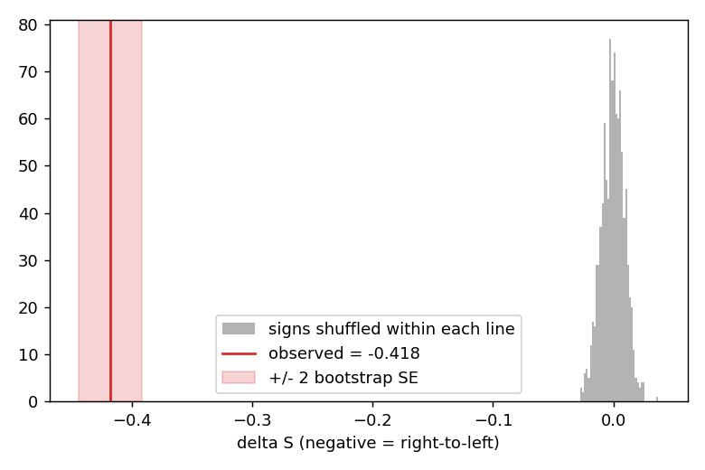
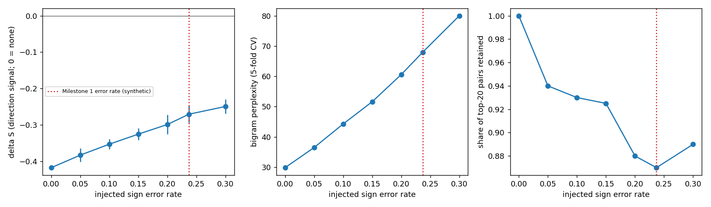

# Milestone 2 report: positional bias and Markov-chain modelling

Generated by `sequence_analysis/run_milestone2.py` from the IM77 corpus (Mahadevan 1977). Signs are Mahadevan numbers; sequences are in reading order unless stated.

**What this does and does not show.** The results show that sign order in the inscriptions is structured and non-random, and that the layout is consistent with right-to-left reading. They are not evidence that the inscriptions encode a language: published work disputes whether any of these statistics separates writing from structured non-linguistic sign systems (Sproat 2014; Rao et al. 2015), and an unreviewed 2026 preprint (Raghavendra, arXiv:2608.02999) reports that an invented non-linguistic system reproduces them.

## Corpus

| Filter step | Lines | Distinct texts | Sign tokens | Signs |
|---|---|---|---|---|
| all inscribed lines | 3573 | 2410 | 10679 | 417 |
| no illegible or lost sign | 2861 | 1849 | 8313 | 398 |
| no doubtful reading | 2591 | 1673 | 7448 | 393 |
| single-line only | 2406 | 1548 | 7000 | 377 |

Keeping one copy of each text after the last step gives **1548 texts, 7000 sign tokens, 377 signs**. Yadav et al. 2010 report 1548, 7000 and 377 for their filtered corpus (EBUDS), so the filter is reproduced exactly.
All statistics below use this filtered corpus except the direction test, which needs the per-line layout.

## Replication of Yadav et al. 2010

| Quantity | Published | This run |
|---|---|---|
| Perplexity, order 1 (Witten-Bell, backoff) | 68.82 | 74.58 (every held-out sign scored); 68.95 (unseen signs skipped) |
| Perplexity, order 2 (Witten-Bell, backoff) | 26.69 | 29.83 (every held-out sign scored); 26.88 (unseen signs skipped) |
| Perplexity, order 3 (Witten-Bell, backoff) | 26.09 | 29.18 (every held-out sign scored); 26.26 (unseen signs skipped) |
| Perplexity, order 4 (Witten-Bell, backoff) | 25.26 | 30.13 (every held-out sign scored); 27.11 (unseen signs skipped) |
| Perplexity, order 5 (Witten-Bell, backoff) | 25.26 | 30.32 (every held-out sign scored); 27.29 (unseen signs skipped) |
| Unigram entropy (bits) | 6.68 | 6.68 plug-in; 6.72 Miller-Madow |
| Adjacent-sign mutual information (bits) | 2.24 | 3.12 (plug-in; not reproduced) |
| Distinct adjacent sign pairs observed | 2,178 (Sinha et al. 2009) | 2178 |
| Signs covering 80% of all tokens / text-beginners / text-enders | 69 / 82 / 23 | 69 / 82 / 23 |
| Three most frequent text-beginners | [267, 391, 293] | [267, 391, 293] |
| Three most frequent text-enders | [342, 176, 211] | [342, 176, 211] |
| Most frequent pair, count, log-likelihood ratio | 267 then 99, 168, 792.40 | 267 then 99, 168, 792.40 |
| Most frequent triplet, count | 336, 89, 211; 34 | [336, 89, 211]; 34 |
| Zipf-Mandelbrot fit (a, b, c) | 15.39, 2.59, 44.47 | 15.39, 2.60, 44.47 |
| Damaged-sign restoration, true sign inside the 90%-probability candidate set | 74% | 86.1%; 79.5% if the sign that crosses the 90% line is not counted |

Notes on comparability:

- **Perplexity.** The headline figure scores every held-out sign over a fixed vocabulary, and is higher than published. The second figure takes the vocabulary from each training fold and skips held-out signs never seen in training (1.6% of events), which is the default behaviour of the SRILM toolkit the paper used. It lands close to the published values for orders 1 to 3, so it is a candidate explanation of the gap, not a confirmed one: the paper does not state its split or options. Skipping drops the hardest events, so the headline figure is the more honest measure. Orders 4 and 5 are not reproduced under either protocol.
- **Mutual information.** The paper does not define its estimator. An independent check of seven definitions found none that gives 2.24. The plug-in value is biased upward: with every token permuted across the corpus it is still 1.94 bits.
- **Restoration.** The published rule can be read two ways at the 90% boundary, and the two readings differ by several points.

## Language models compared (5-fold cross-validation over distinct texts)

| Model | Bits per event (mean, SD over folds) | Perplexity | Perplexity without end-of-text |
|---|---|---|---|
| uniform | 8.562, 0.000 | 378.00 | 378.00 |
| positional (no sign-to-sign dependence) | 5.970, 0.063 | 62.70 | 117.06 |
| witten-bell backoff n=1 | 6.221, 0.037 | 74.58 | 131.23 |
| witten-bell interpolated n=1 | 6.221, 0.037 | 74.58 | 131.23 |
| witten-bell backoff n=2 | 4.899, 0.092 | 29.83 | 51.49 |
| witten-bell interpolated n=2 | 4.909, 0.099 | 30.05 | 53.33 |
| witten-bell backoff n=3 | 4.867, 0.101 | 29.18 | 50.13 |
| witten-bell interpolated n=3 | 4.941, 0.105 | 30.72 | 55.77 |
| witten-bell backoff n=4 | 4.913, 0.111 | 30.13 | 51.30 |
| witten-bell interpolated n=4 | 5.045, 0.116 | 33.02 | 60.68 |
| witten-bell backoff n=5 | 4.922, 0.113 | 30.32 | 51.42 |
| witten-bell interpolated n=5 | 5.086, 0.117 | 33.98 | 62.62 |
| add-1 n=2 | 6.149, 0.051 | 70.94 | 106.21 |
| add-0.01 n=2 | 5.302, 0.124 | 39.44 | 68.60 |
| kneser-ney n=2 | 4.827, 0.087 | 28.38 | 49.09 |

The positional model, which knows only how far into the text a sign is, reaches 5.970 bits per event; the bigram model reaches 4.899. The baseline knows position counted from the start only, so part of the difference may still be end-of-text position.
The vocabulary is fixed at the 377 signs of the filtered corpus plus end-of-text; every model gives unseen signs non-zero probability.

## Is sign order structured?

Adjacent-sign mutual information is 3.115 bits. After shuffling the signs inside each text it is 2.066 bits (95% of shuffles in [2.038, 2.094]; p < 0.001). With every token permuted across the whole corpus it is 1.935 bits, which is the size of the estimator's upward bias on data this sparse; the comparison is therefore against shuffles and not against zero.

Of the 2178 distinct adjacent pairs, 205 occur at least 5 times and were tested (log-likelihood ratio, Benjamini-Hochberg at 5%): 179 occur more often than chance and 4 less often. The same procedure on a corpus with all tokens permuted flags 1.1 pairs on average. Rarer pairs are listed but not tested, because the test is unreliable at expected counts below about 1. Full table with pointwise mutual information: `sign_pairs.csv`. Forward and backward transition matrices: `transition_matrices.npz`.

## Writing direction

**What this test can show.** The corpus stores each text in reading order and labels each line right-to-left or left-to-right. Each line was put back into its physical left-to-right layout using that label, and the measure of Ashraf & Sinha (2018) was applied to the signs at the two physical ends. Negative delta S and positive delta G mean the left end is the more predictable one, which in scripts of known direction goes with right-to-left reading.

The result is conditional on Mahadevan's labels and is not an independent verification of direction. In stored reading order the last-read end is the more concentrated one in both groups (delta S +0.395 for lines labelled right-to-left, +0.324 for left-to-right), so the physical values below are that fact combined with the label. What the data supports is: given the recorded labels, the concentrated end is on the physical left in the lines labelled right-to-left, which are 92% of lines with a recorded direction. A test that does not depend on the labels needs layout from another source, such as sign positions measured on photographs (Milestone 1's `bbox_xywh`) or the printed concordance. The proposal asks for 'verifying right-to-left syntax rules'; this report claims consistency with a right-to-left convention and makes no claim about syntax.

| Group | Lines | delta S (bootstrap SE) | delta S under within-line shuffle (95%) | p | delta G (bootstrap SE) |
|---|---|---|---|---|---|
| primary: labelled right-to-left, single-line | 2319 | -0.418 (0.013) | [-0.020, +0.019] | 0.001 | +0.141 (0.006) |
| same, duplicate texts removed | 1565 | -0.413 (0.018) | [-0.022, +0.022] | 0.001 | +0.162 (0.008) |
| labelled right-to-left, all lines | 2461 | -0.395 (0.013) | [-0.017, +0.019] | 0.001 | +0.142 (0.006) |
| labelled left-to-right, all lines | 210 | +0.324 (0.033) | [-0.068, +0.066] | 0.001 | -0.055 (0.005) |
| labelled left-to-right, single-line | 194 | +0.333 (0.034) | [-0.059, +0.062] | 0.001 | -0.051 (0.005) |
| right-to-left single-line, object_type = seal | 1314 | -0.444 (0.020) | [-0.026, +0.025] | 0.001 | +0.147 (0.007) |
| right-to-left single-line, object_type = sealing | 469 | -0.477 (0.027) | [-0.045, +0.041] | 0.001 | +0.088 (0.005) |
| right-to-left single-line, object_type = miniature tablet | 336 | -0.459 (0.032) | [-0.057, +0.053] | 0.001 | +0.035 (0.003) |
| right-to-left single-line, object_type = copper tablet | 118 | -0.603 (0.056) | [-0.080, +0.074] | 0.001 | +0.017 (0.002) |
| right-to-left single-line, site = Mohenjodaro | 1203 | -0.450 (0.019) | [-0.025, +0.028] | 0.001 | +0.134 (0.007) |
| right-to-left single-line, site = Harappa | 891 | -0.484 (0.020) | [-0.034, +0.033] | 0.001 | +0.100 (0.005) |

In the primary group, sign 342 (the commonest text-ender) is at the physical left end of 766 lines and at the right end of 0, out of 2319. In lines labelled left-to-right it is at the left end of 0 and the right end of 40, out of 210. No exceptions in either group is what one would expect if the labels were assigned with the position of such signs in view.
Descriptively, the gap in delta S between the two labelled groups is -0.720, against [-0.094, +0.082] when labels are reassigned at random; this follows from the labels and is not separate evidence.

p is the share of within-line shuffles with an absolute delta S at least as large as observed; 0.001 is the smallest value 1,000 shuffles can give. delta S (entropy) is the headline measure because it is stable across group sizes. delta G (Gini) shrinks as a group gets smaller and sparser, so its size should not be compared between groups. delta G here is computed over the full 418-symbol sign list so that groups share one alphabet; over only the signs seen at either end, which is closer to Ashraf & Sinha's usage, the primary group gives +0.203. A bootstrap standard error is given in place of a percentile interval because both measures are biased on sparse counts and resampling repeats the bias.

Other limits: the left-to-right group is small and unrepresentative (many are miniature tablets from Harappa). Comparing forward and backward bigram perplexity is not a direction test: a maximum-likelihood bigram model scores a corpus identically in both directions (asserted in `ngram.py`).

## Error propagation from Milestone 1

Recognition errors (substitution, deletion, and insertion on a random side, in equal parts) were injected into the corpus and the analysis repeated.

| Injected sign error rate | delta S (mean, SD) | delta G (mean, SD) | Bigram perplexity | Top-20 pairs retained | Texts ending in the top ender |
|---|---|---|---|---|---|
| 0.000 | -0.418, 0.000 | +0.141, 0.000 | 29.8 | 100% | 34.0% |
| 0.050 | -0.383, 0.009 | +0.144, 0.006 | 36.5 | 94% | 32.8% |
| 0.100 | -0.353, 0.007 | +0.146, 0.004 | 44.3 | 93% | 31.3% |
| 0.150 | -0.325, 0.008 | +0.145, 0.007 | 51.6 | 92% | 30.2% |
| 0.200 | -0.299, 0.013 | +0.148, 0.011 | 60.6 | 88% | 29.1% |
| 0.237 (Milestone 1, synthetic) | -0.271, 0.012 | +0.138, 0.009 | 68.0 | 87% | 27.8% |
| 0.300 | -0.249, 0.010 | +0.144, 0.012 | 80.0 | 89% | 26.1% |

The conclusions weaken but do not reverse: the direction signal shrinks toward zero, the commonest pairs mostly survive, and perplexity rises steeply. Milestone 1's sign error rate (0.237) was measured on synthetic seals and is optimistic for real photographs. The injected errors are uniform over signs; a real classifier confuses similar-looking signs, which this does not model.

## Restoring a missing sign

With one sign removed and predicted from both neighbours by the bigram model (7000 trials, 5-fold): top-1 38.0%, top-5 62.4%, and the true sign is inside the 90%-probability candidate set 86.1% of the time (that set holds 44 signs on average). The published 74% uses the last criterion; it is not top-1 accuracy. This measures how predictable the notation is and says nothing about meaning.
