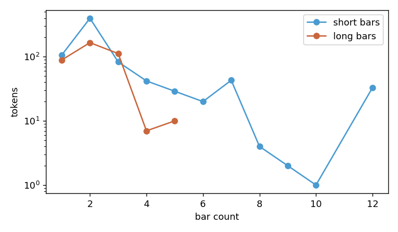

# Do the stroke signs behave like numerals? (exploratory)

Signs drawn as a row of equal thin bars are often called numerals. If they are, several things should hold, and each can fail. The stroke signs are found from the 417 glyph drawings by a rule: every connected part is a thin near-vertical bar (height at least 3 times width) and the bars are within 20% of one another in height. The rule selected 25 signs (contact sheet: `numerals_contact_sheet.png`; label = sign number, bar count, S or L for short or long bars, and the number of rows). A first version of the rule, without the fill condition, also selected 0 curved or looped signs (); requiring each part to fill at least half of its bounding box, a lone bar to be at least 5 times as tall as wide, and bar widths to agree within a factor of 2 removed them. Bars are called long when taller than a third of the drawing.

Texts: the 1,548 distinct single-line inscriptions of the filtered corpus (Milestone 2). Each stroke-sign measure is compared with 1,000 pseudo sets of the same size made of non-stroke signs, each chosen at random from the 20 non-stroke signs nearest in frequency to the stroke sign it replaces. Contexts need at least 10 tokens, so 14 stroke signs enter the context tests. All six p-values form one Benjamini-Hochberg family.

| Stroke sign | Count | Bars | Rows | Tokens |
|---|---|---|---|---|
| 86 | 1 | long | 1 | 89 |
| 87 | 2 | long | 1 | 166 |
| 89 | 3 | long | 1 | 112 |
| 95 | 4 | long | 1 | 7 |
| 96 | 5 | long | 1 | 10 |
| 97 | 1 | short | 1 | 56 |
| 98 | 1 | short | 1 | 50 |
| 99 | 2 | short | 1 | 377 |
| 100 | 2 | short | 1 | 20 |
| 101 | 2 | short | 2 | 1 |
| 102 | 3 | short | 1 | 74 |
| 103 | 3 | short | 2 | 9 |
| 104 | 4 | short | 1 | 40 |
| 105 | 4 | short | 2 | 2 |
| 106 | 5 | short | 1 | 24 |
| 107 | 5 | short | 2 | 5 |
| 108 | 6 | short | 1 | 3 |
| 109 | 6 | short | 2 | 17 |
| 110 | 7 | short | 1 | 5 |
| 112 | 7 | short | 2 | 38 |
| 114 | 8 | short | 2 | 4 |
| 115 | 9 | short | 1 | 1 |
| 116 | 9 | short | 2 | 1 |
| 118 | 10 | short | 2 | 1 |
| 121 | 12 | short | 2 | 33 |

## Results

| Prediction | Stroke signs | Pseudo sets: mean (sd) | p | BH q |
|---|---|---|---|---|
| Counted things: stroke signs are followed by a narrower set of signs (entropy of the next sign, bits) | 3.792 | 2.798 (0.294) | 1.0000 | 1.000 |
| Counted things: different stroke signs are followed by the same signs (mean Jensen-Shannon divergence) | 0.764 | 0.778 (0.038) | 0.3457 | 0.415 |
| Interchangeability: text pairs differing only in which stroke sign stands in one position | 116.000 | 34.792 (14.674) | 0.0010 | 0.005 |
| Position: share of stroke-sign tokens at the end of a text | 0.058 | 0.192 (0.105) | 0.1668 | 0.250 |
| Runs: adjacent pairs of stroke signs (additive systems show them, positional ones do not) | 159.000 | 95.867 (38.774) | 0.0659 | 0.132 |
| Frequency falls with value: Spearman rank correlation of bar count with tokens | -0.60 | - | 0.0016 | 0.005 |

Frequency by count (tokens): short bars {1: 106, 2: 398, 3: 83, 4: 42, 5: 29, 6: 20, 7: 43, 8: 4, 9: 2, 10: 1, 12: 33}; long bars {1: 89, 2: 166, 3: 112, 4: 7, 5: 10}. Separate correlations: short -0.78, long -0.6.

Share of tokens at the start of a text: stroke signs 0.173, all signs 0.221; at the end: stroke signs 0.058, all signs 0.221.

## Reading

- Counted things: stroke signs are followed by a narrower set of signs (entropy of the next sign, bits): does not hold (observed 3.792 against 2.798 for matched pseudo sets, q 1.000); a numeral-like result would be lower.
- Counted things: different stroke signs are followed by the same signs (mean Jensen-Shannon divergence): does not hold (observed 0.764 against 0.778 for matched pseudo sets, q 0.415); a numeral-like result would be lower.
- Interchangeability: text pairs differing only in which stroke sign stands in one position: holds (observed 116.000 against 34.792 for matched pseudo sets, q 0.005); a numeral-like result would be higher.
- Position: share of stroke-sign tokens at the end of a text: does not differ from matched pseudo sets (observed 0.058 against 0.192, q 0.250); this test has no single numeral-like direction.
- Runs: adjacent pairs of stroke signs (additive systems show them, positional ones do not): does not differ from matched pseudo sets (observed 159.000 against 95.867, q 0.132); this test has no single numeral-like direction.
- Frequency by value: rank correlation -0.60 (q 0.005); numerals would fall with value, so a negative correlation is the numeral-like result.

This does not decide whether the signs are numerals. It lists which numeral-like behaviours are present and which are not.

## Limits

The detection rule fixes what counts as a stroke sign; a different rule gives a different set. Many stroke signs are rare, so context distributions are thin. Pseudo sets are matched on frequency only. Texts are short. Settings: seed 20261116, runtime 0.5 min, quick run: False.
