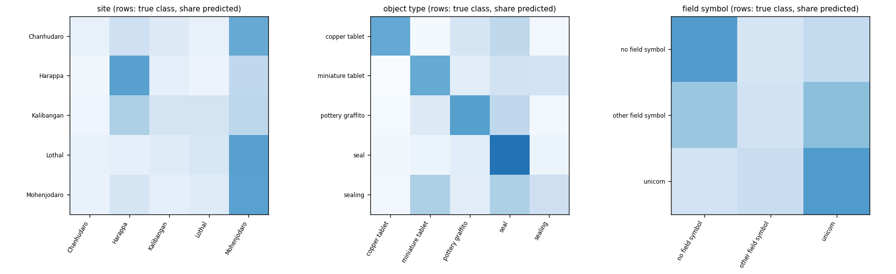

# Does the text predict the object? (exploratory)

Milestone 2 found differences in the sign sequences by site, object type and field symbol. This asks how much can be predicted. Rows: the 2,406 inscribed lines of the filtered corpus (damaged, doubtful and multi-line texts removed, copies kept because each is its own object), with their metadata. Features: counts of signs and of adjacent sign pairs, plus the text length. Model: logistic regression (C 0.3) with balanced class weights; features seen in fewer than 3 training texts are ignored. Score: 5-fold cross-validation grouped by text (copies of one inscription never straddle a fold), mean over 3 repeats of the fold split. Metric: balanced accuracy (mean recall per class; chance is 1 over the number of classes). Permuted baseline: labels shuffled within the training folds, 30 times (so p cannot fall below 0.032). Classes with fewer than 30 rows are left out.

| Target | Classes | Rows | Chance | Majority | Text length only | Signs only | Signs and pairs | Macro F1 | Permuted labels (mean, max) | p |
|---|---|---|---|---|---|---|---|---|---|---|
| site | 5 | 2,375 | 20% | 20% | 22% | 31% | 31% ± 1.5 | 29% | 20%, 24% | 0.032 |
| object type | 5 | 2,364 | 20% | 20% | 42% | 52% | 50% ± 1.5 | 44% | 21%, 26% | 0.032 |
| field symbol | 3 | 2,406 | 33% | 33% | 40% | 44% | 46% ± 1.0 | 46% | 33%, 38% | 0.032 |

Classes left out for having fewer than 30 rows: site: Other sites (23), West Asian finds (8); object type: ivory/bone rod (19), miscellaneous (13), bronze implement (10); field symbol: none.

## Confounds

Site, object type and field symbol are correlated with each other. Balanced accuracy of the signs-and-pairs model within the largest class of each other variable:

| Target | Within | Rows | Classes | Balanced accuracy | Chance |
|---|---|---|---|---|---|
| site | object type = seal | 1,253 | 5 | 24% | 20% |
| site | field symbol = no field symbol | 1,176 | 3 | 51% | 33% |
| object type | site = Mohenjodaro | 1,136 | 3 | 48% | 33% |
| object type | field symbol = no field symbol | 1,190 | 5 | 44% | 20% |
| field symbol | site = Mohenjodaro | 1,183 | 3 | 46% | 33% |
| field symbol | object type = seal | 1,271 | 3 | 41% | 33% |

## Signs with the largest weights

Sign numbers, by absolute weight in a signs-only model fitted on all rows (not a causal statement; the weights of rare signs are noisy):

- site: Chanhudaro: 69 14 139 214 180 109 198 293 326 12; Harappa: 328 176 210 12 17 89 67 121 95 99; Kalibangan: 336 167 206 15 65 8 73 344 76 121; Lothal: 113 66 176 286 341 258 123 32 387 292; Mohenjodaro: 296 107 242 367 63 336 124 112 345 397
- object type: copper tablet: 190 407 363 176 204 184 319 194 169 348; miniature tablet: 176 328 95 103 169 99 319 347 345 267; pottery graffito: 365 328 167 345 72 53 336 41 363 59; seal: 328 28 99 12 48 365 60 65 391 17; sealing: 328 63 321 135 113 127 99 373 176 230
- field symbol: no field symbol: 210 328 169 389 137 407 18 149 45 180; other field symbol: 321 398 63 45 113 169 389 10 287 297; unicorn: 328 125 113 321 12 14 188 304 192 28

## Reading

site: 31% balanced accuracy against 20% chance and 24% at most for permuted labels (p 0.032); text length alone gives 22%, and adding pairs to single signs changes it by +0.1 points. object type: 50% balanced accuracy against 20% chance and 26% at most for permuted labels (p 0.032); text length alone gives 42%, and adding pairs to single signs changes it by -2.1 points. field symbol: 46% balanced accuracy against 33% chance and 38% at most for permuted labels (p 0.032); text length alone gives 40%, and adding pairs to single signs changes it by +1.5 points.

## Limits

Classes are very unbalanced and the metadata categories are Mahadevan's. Texts are short (median 4 signs), so a ceiling far below 100% is expected. Pairs of signs help only if order carries information beyond counts. Repeats of the fold split are not independent resamples of the data. Settings: seed 20261116, runtime 0.8 min, quick run: False.
