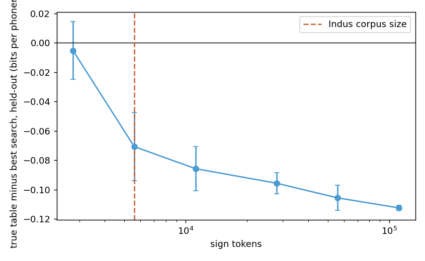

# How large would the corpus have to be? (exploratory, not pre-registered)

The blind-search extension (`overfitting_report.md`) found that on a corpus of Indus size a hill-climbing search reaches scores above a true table, so the score cannot pick out a correct table. This asks at what corpus size it can. Sanskrit is enciphered with the Yajnadevam 2026-07-15 sign-to-sound relation, so the true table is known, into corpora from 0.5 to 20 times the size of the Indus corpus used in Milestone 4 (5,584 sign tokens). The scoring trigram comes from one half of the Sanskrit chapters and the plaintext from the other half.

At each size, 4 independent replicates: (a) a permutation test of the true table against 500 shuffles of its own values; (b) 5 blind searches of 2,000 swaps each, fitted on a random half of the texts and scored on the other half; (c) the true table's score on that other half minus the best searched table's; (d) the share of sign tokens a searched table reads with the same consonants as the true table.

| Size (x Indus) | Sign tokens | Replicates | Power at p < 0.05 | True table beats every search on held-out texts | Margin, true minus best search (bits) | Agreement of searched with true |
|---|---|---|---|---|---|---|
| 0.5 | 2,793 | 4 | 100% | 75% | -0.005 ± 0.020 | 5% |
| 1 | 5,587 | 4 | 100% | 0% | -0.071 ± 0.023 | 5% |
| 2 | 11,169 | 4 | 100% | 0% | -0.086 ± 0.015 | 5% |
| 5 | 27,921 | 4 | 100% | 0% | -0.096 ± 0.007 | 3% |
| 10 | 55,840 | 4 | 100% | 0% | -0.106 ± 0.009 | 4% |
| 20 | 111,681 | 4 | 100% | 0% | -0.112 ± 0.002 | 4% |

## Reading

The true table does not beat every blind search in 80% of replicates at any size run, up to 20 times the Indus size (111,681 sign tokens). The permutation test against shuffled tables detects the true table at every size (power 100%, 100%, 100%, 100%, 100%, 100%), so what fails is the comparison with searched tables: a plain blind search finds tables that score above the true one on held-out texts at every size, and the tables it finds read only 3-5% of tokens the way the true table does. With this score, the true table is not what a search maximises, however large the corpus, so scoring below the search ceiling is not evidence against a table and scoring above shuffled tables is not evidence for one.

## Limits

One key and one language. Enciphered Sanskrit is cleaner than any real inscription (no damaged signs, no variant spellings, the true reading is exactly Sanskrit). The search is a plain hill climb of a fixed length that has not necessarily converged on the largest corpora, so a better search would need an even larger corpus. Settings: seed 20261116, runtime 54.2 min, quick run: False.
