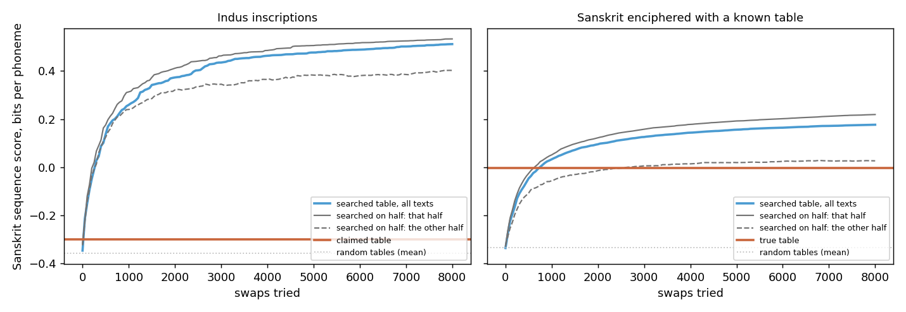

# Milestone 4 extension: how high can a table score by fitting alone?

**Exploratory, not pre-registered.** This analysis was written after the Milestone 4 results were known and is outside the corrected family of tests in `decipherment/prereg.json`. Nothing here changes the Milestone 4 result.

The Milestone 4 test compares a claimed table with random tables. A decipherer does not pick a table at random: they search for one that reads well. So here random tables are searched too. Each starts as a shuffle of the claim's own sound values and is improved by swapping the values of two signs whenever that does not lower the Sanskrit sequence score (8,000 swaps tried, 20 searches). The search knows no Sanskrit beyond the score and nothing about the inscriptions' meaning.

The same search is run on a control where the right answer is known: held-out Sanskrit text enciphered with the claim's own sign-to-sound relation and cut to the lengths of real inscriptions (5 fresh encipherments, averaged). The control column shows what a correct table looks like under exactly the same treatment.

Claim: Yajnadevam, version of 15 July 2026 (1,318 texts, 5,584 sign tokens, 188 groups of signs that occur in them). All scores are bits per phoneme; higher is more Sanskrit-like.

| | Indus inscriptions, claimed table | Enciphered Sanskrit, true table |
|---|---|---|
| The table itself | -0.299 | -0.002 |
| Random tables (same values, shuffled) | -0.358 ± 0.119 | -0.335 ± 0.046 |
| Random tables after 8,000 search steps | +0.511 ± 0.026 | +0.176 ± 0.007 |
| Searched tables that end above the table | 100% | 100% |
| Search steps until the median search passes the table | 50 | 750 |
| Searched on half the texts: score on that half | +0.537 ± 0.034 | +0.220 ± 0.009 |
| Searched on half the texts: score on the other half | +0.400 ± 0.044 | +0.026 ± 0.017 |
| The table on the other half | -0.293 ± 0.015 | -0.003 ± 0.010 |
| Random tables on the other half | -0.341 ± 0.103 | -0.329 ± 0.042 |
| Splits where the searched table beats the table on the other half | 100% | 87% |
| Sign tokens two searched tables read alike | 26% | 17% |
| Sign tokens a searched table reads like the table | 9% | 4% |
| Sign tokens two random tables read alike (chance) | 4% | 4% |
| The table after the same search: score | +0.536 | +0.147 |
| The table after the same search: tokens still read the same | 17% | 38% |

## Reading the numbers

- **Ceiling.** On the Indus inscriptions a blind search ends +0.810 bits per phoneme above the claimed table, and 100% of searches end above it. On enciphered Sanskrit the search ends +0.179 above the true table (100% of searches above it).
- **Held-out half.** A table searched on half the Indus texts scores +0.400 on the half it never saw; the claimed table scores -0.293 there and a random table -0.341. In the control the searched table scores +0.026 on the unseen half and the true table -0.003. The claimed table was fitted by its author to all the texts, so neither half is unseen for it; its two halves are shown only as the reference level.
- **Do searches agree?** Two independent searches on the Indus texts read 26% of sign tokens with the same consonants (chance: 4%); in the control 17% (chance 4%), and a searched table agrees with the true table on 4% of tokens.
- **What separates the two columns.** On text the search has not seen, a searched table is +0.028 from the true table in the control and +0.692 from the claimed table on the Indus inscriptions. One caution: the Indus texts are formulaic, so what a search learns on one half carries over to the other more easily than in the control, where each sound is written with a randomly chosen sign among those that carry it. The two gaps are therefore not on the same footing.

## What this does and does not show

- It shows how much of a Sanskrit-like score is available to any table through search alone, on this corpus and with this score. A score that a blind search reaches or passes cannot by itself be evidence that a table is right.
- The search passes the true table in the control as well, with tables that disagree with it. So scoring below the search ceiling is what a correct table does too and is not evidence against the claim; and the sequence score alone cannot pick out the right table on a corpus of this size. The Milestone 4 positive control (true table against shuffles) is a different and easier question.
- It does not show the claimed table was produced by such a search, and it does not test the claimant's own reading method (conjuncts, vowels and per-text choices are outside a sign-by-sign table, as in Milestone 4).
- The control is optimistic for the true table: the enciphered text comes from the same corpus as the scoring model, and it is enciphered sign by sign with no noise. A real Bronze Age language would sit lower.
- The search is plain greedy swapping from one start with the claim's value inventory fixed. A stronger search would reach higher, so the ceiling reported here is a lower bound on what fitting can reach.
- If independent searches disagree with each other about what the signs say while scoring alike, the score does not pin down one table on a corpus this size. That is an empirical version of the unicity-distance argument, for this score only.

Settings: 20 searches and 20 half-splits of 8,000 swaps each on the Indus texts; 5 encipherments with 6 searches and 6 half-splits each; seed 20261114. Run time 7 minutes on a laptop CPU.
